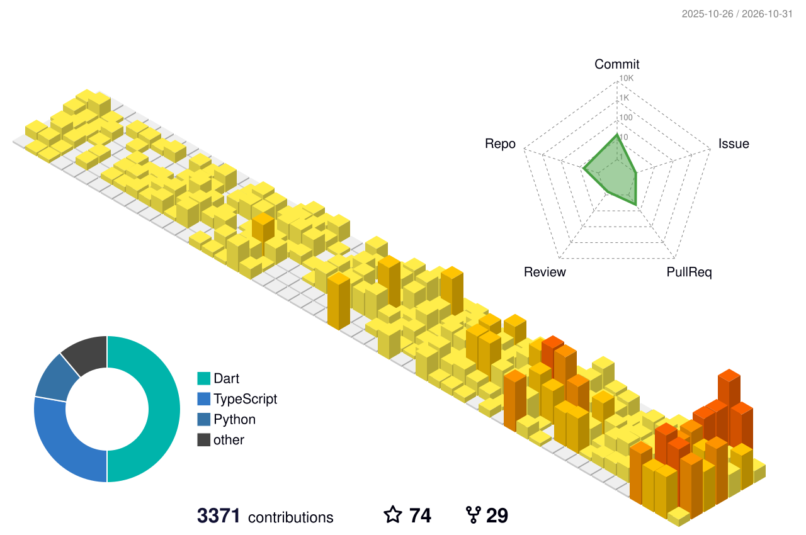

### Hi there 👋
- 👋 Hi, I’m **Mahady Hasan** (mahadydev), a Software Engineer based in ***Dhaka, Bangladesh***.
- 👨‍💻 Flutter enthusiast. ***Good at Dart, Flutter, Mobile Apps***
- 🌱 I’m currently focused on [***Flutter***](https://github.com/flutter/flutter) contributions, [***flutter_starter_project***](https://github.com/mahadydev/flutter_starter_project) and [***wallcraft_manager***](https://github.com/mahadydev/wallcraft_manager).
- 📚 I’m currently learning TypeScript and backend development.
- 👉 [Here](https://mahadydev.vercel.app) is my personal website.
- 📫 How to reach me: mahady@appifylab.com

### Technologies 💻
<table>
  <tr>
    <td></td>
    <td></td>
    <td></td>
    <td></td>
    <td></td>
    <td></td>
    <td></td>
  </tr>
  <tr>
    <td></td>
    <td></td>
    <td></td>
    <td></td>
    <td></td>
    <td></td>
    <td></td>
  </tr>
  <tr>
    <td></td>
    <td></td>
    <td></td>
    <td></td>
    <td></td>
    <td></td>
    <td></td>
  </tr>
</table>

### Profile Views
counting of visitors to this page in this section started from October 31, 2026

